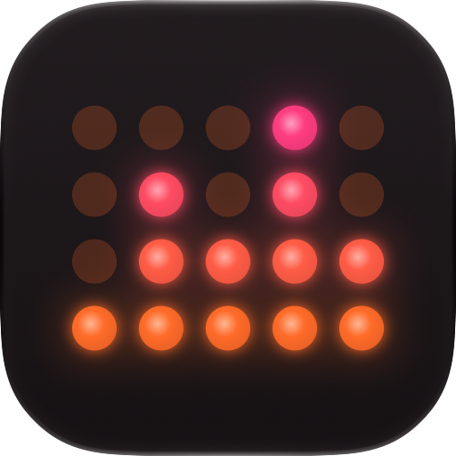
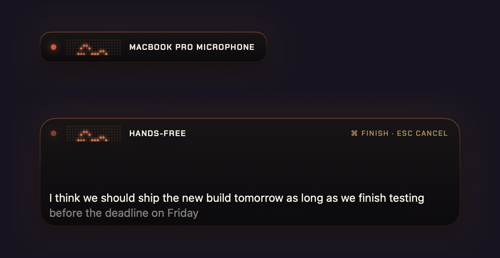
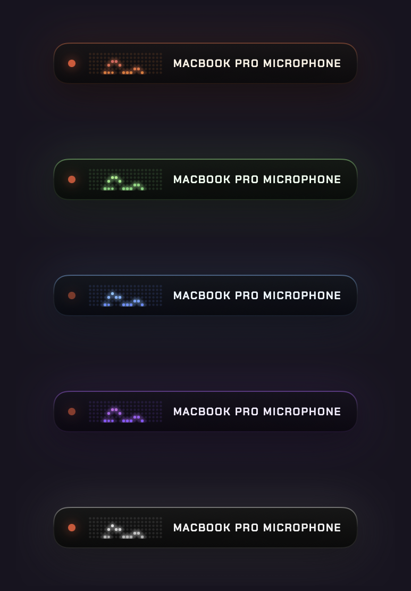
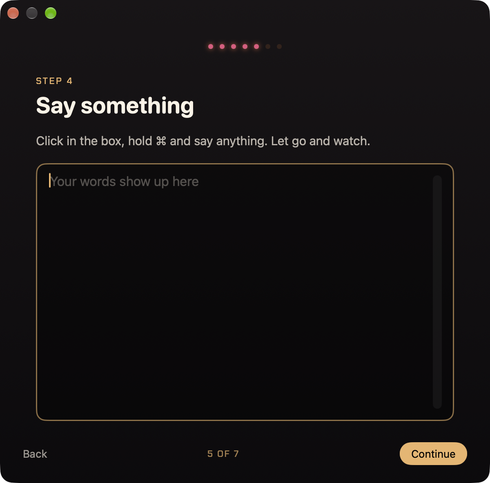
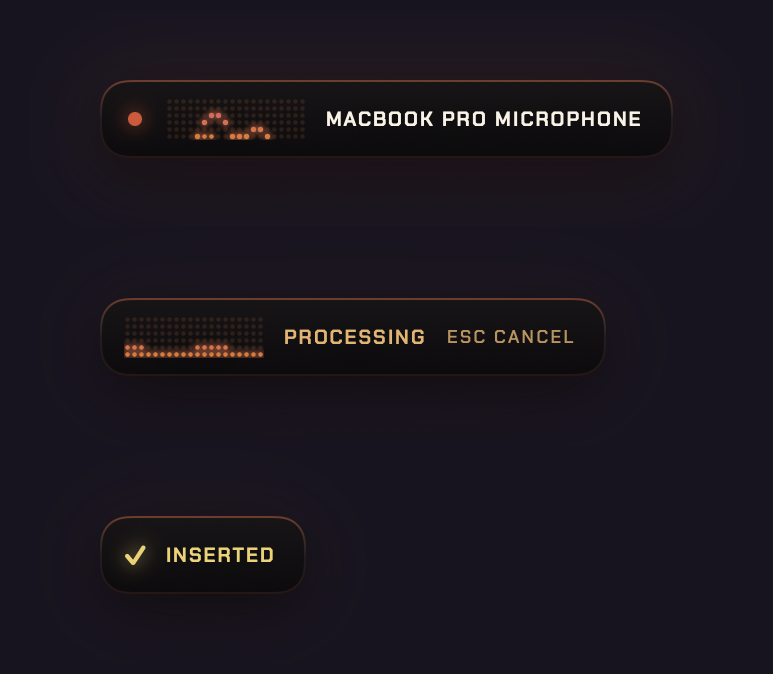
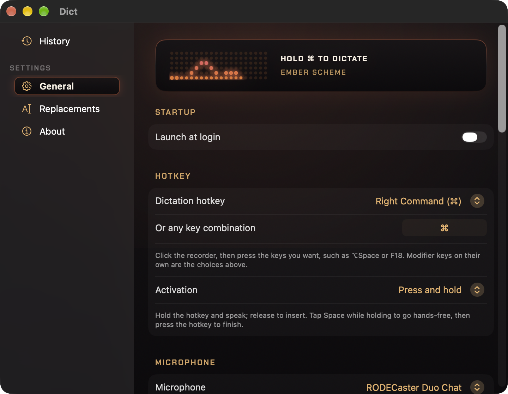
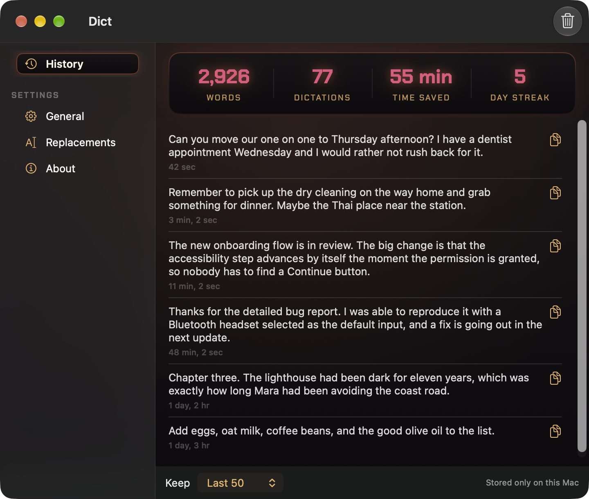

  

<h1 align="center">Dict</h1>

  Private dictation for the Mac. Hold a key, talk, let go. 
  Everything runs on your Mac. Nothing you say leaves it.

  <a href="https://github.com/mattbirchler/Dict-releases/releases/latest"><b>Download for macOS</b></a>
  &nbsp;&middot;&nbsp;
  <a href="https://github.com/mattbirchler/Dict-releases/releases">Release notes</a>
  &nbsp;&middot;&nbsp;
  <a href="PRIVACY.md">Privacy</a>

  

## What it is

Dict is a dictation app that lives in your menu bar. Hold the dictation key (Right Command, unless you pick another), say what you want to type, and let go. A moment later the text is sitting in whatever app you were in: a message, a document, a code editor, a search box.

The speech recognition runs on your Mac, using either Apple's built-in engine or NVIDIA's Parakeet model. There is no account, no subscription and no usage limit. Try it free for 14 days, then [buy it once](https://store-production-8e91.up.railway.app/buy) and it's yours on all of your Macs.

## Why you might want it

- **Private by construction.** Audio, transcripts and history never leave your Mac. The only network requests Dict makes are checking for updates and, if you ask for it, downloading the Parakeet model. Details in [PRIVACY.md](PRIVACY.md).
- **Accurate.** Apple's engine is ready the moment you install. Parakeet is a one-time 500 MB download that is noticeably better on names, technical terms and long sentences, and Dict switches over by itself when the download finishes.
- **Your key, your way.** Use Right Command, Right Option, Right Control or Fn, or record any combination you like. Choose press-and-hold or press-to-toggle.
- **Hands-free when you need it.** Tap Space while holding the key and Dict keeps listening until you press Command to finish. The panel grows to show the words as they arrive.
- **Three dictation styles.** Verbatim keeps every word. Clean drops the ums, uhs and repeated words, and keeps only your corrected version when you change your mind mid-sentence. Polished adds small grammar fixes. Clean and Polished use Apple Intelligence on your Mac, so nothing leaves it.
- **Knows what you're typing into.** Dict reads the field you are dictating into and spells names, acronyms and identifiers the way they already appear there. In editors and terminals it formats code terms properly. Both can be turned off.
- **Word replacements.** Teach Dict the words it keeps getting wrong.
- **History and stats.** Every dictation is kept on your Mac, with a limit you choose, and the top of the list shows words dictated, time saved and your day streak.
- **Looks the part.** A small panel with a live spectrum in five color schemes: Ember, Phosphor, Glacier, Ultraviolet and Graphite.

  

## Install

1. [Download the latest disk image](https://github.com/mattbirchler/Dict-releases/releases/latest) (`Dict-<version>-<build>.dmg`).
2. Open it and drag Dict to the Applications folder, then open Dict from there.
3. Follow the short setup. Dict asks for Microphone access so it can hear you and Accessibility access so it can type for you, and explains each one as it goes. You get to try dictating before setup is over.

Dict needs **macOS 26 or later** on a Mac with **Apple silicon**. Updates arrive through the app itself: Check for Updates in the menu, or automatically once a day.

## Buying Dict

Every feature works for 14 days. After that, dictation stops until you enter a license key (your settings and history stay put). [Buy Dict](https://store-production-8e91.up.railway.app/buy) through Stripe, then click **Activate in Dict** on the confirmation page. The key works on all of your Macs and is checked on your Mac: Dict never contacts a server to confirm it.

  

## Using Dict

| Do this | And Dict |
| --- | --- |
| Hold the key and speak, then let go | types what you said where your cursor is |
| Tap Space while holding the key | goes hands-free and keeps listening; press Command to finish |
| Press Escape | cancels the recording, or a transcription still in progress |
| Open the menu bar icon | shows a dictation style switcher, Copy Last Dictation, History and Settings |

The menu bar icon follows the microphone while you talk, so you can see Dict is listening even when the panel is off to the side.

  

## Settings and history

  

  

## The two engines

| | Apple | Parakeet |
| --- | --- | --- |
| Where it runs | On your Mac | On your Mac |
| Download | None, ready immediately | About 500 MB, once |
| Strengths | Instant start, shows words as you speak | Better accuracy on names, jargon and long dictations; punctuates on its own |
| Languages | English (US) | 25 European languages |

Switch between them in Settings. Punctuation, capitalization and the Clean and Polished styles use the on-device Apple Intelligence model when it is available, and never change the words you said. Without Apple Intelligence, Clean and Polished fall back to a narrow rule-based pass that only removes filler sounds.

## Privacy, in one paragraph

Audio, transcripts, history, settings and the text Dict reads from your screen stay on your Mac. Dict makes two kinds of network request and nothing else: downloading the Parakeet model when you choose that engine, and checking GitHub for updates. Your license key is checked on your Mac, not online. There are no accounts, no analytics and no crash reporting. [PRIVACY.md](PRIVACY.md) has the full statement.

## Found a problem?

[Open an issue](https://github.com/mattbirchler/Dict-releases/issues). The About window has a Copy Diagnostic Log button; the log contains timings and error messages, never your audio or text.

## Thanks

Dict is built on [FluidAudio](https://github.com/FluidInference/FluidAudio) (Apache 2.0), NVIDIA's Parakeet TDT model (CC BY 4.0), [Sparkle](https://sparkle-project.org) (MIT) for updates, and the [Chakra Petch](https://fonts.google.com/specimen/Chakra+Petch) typeface (OFL) for the panel's labels.
